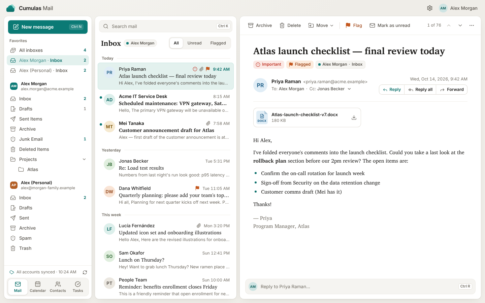
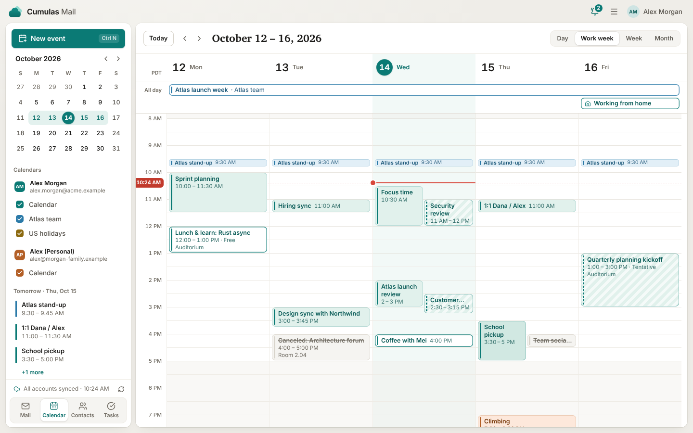
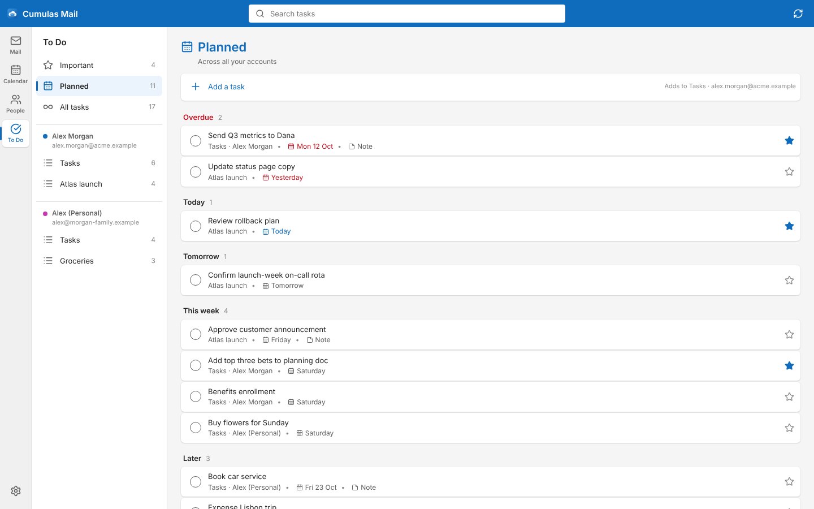
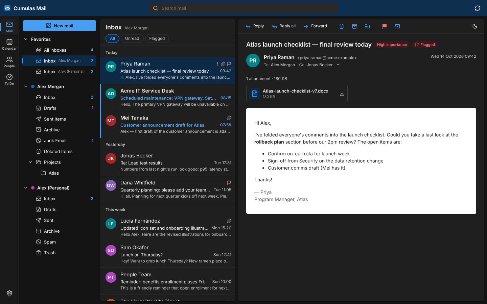

# Cumulas Mail

A fast, focused mail, calendar, contacts and tasks app for Linux. It works
with **Microsoft 365 and Outlook.com** accounts (through Microsoft Graph) and
any **IMAP/SMTP** account. Built with [Tauri 2](https://tauri.app) (Rust) and
React, packaged for Flathub as `co.cumulas.Mail`.

> Status: early development. Everything below works against test servers;
> Microsoft 365 has been tested against a mock Graph server only (see
> [Before release](#before-release)).



| Calendar                                                  | To Do                                              | Dark mode                                     |
| --------------------------------------------------------- | -------------------------------------------------- | --------------------------------------------- |
|  |  |  |

## Features

- **Mail**: folders and favorites, unified inbox, reading pane (right,
  bottom or off), rich-text compose with attachments,
  reply/reply all/forward, flag, archive, move (drag and drop), undo, instant
  offline search, and the keyboard shortcuts people switching from other mail
  clients expect (Ctrl+R, Ctrl+Shift+R, Ctrl+F, Ctrl+Q…).
- **Calendar**: day, work week, week and month views, all-day and multi-day
  events, meeting invitations (accept / tentative / decline), Teams meetings
  for Microsoft accounts.
- **People**: contacts with search, editing and "send email".
- **To Do**: Microsoft To Do lists, Important and Planned views, due dates,
  notes.
- **Accounts**: Microsoft 365 and Outlook.com sign-in in the browser (no
  passwords in the app); IMAP/SMTP with presets for Gmail, iCloud, Fastmail,
  Yahoo and Proton Mail Bridge. IMAP accounts get a local calendar, contacts
  and task list.
- **Privacy and security**: remote images and tracking pixels blocked by
  default; message HTML sanitized and shown in a sandbox without scripts;
  passwords and tokens kept in the system keyring (Secret portal in Flatpak);
  no telemetry.

## Development

Requirements: Rust (stable), Node.js 22, and the Tauri system libraries:

```sh
sudo apt install libwebkit2gtk-4.1-dev libgtk-3-dev libsoup-3.0-dev \
  libayatana-appindicator3-dev librsvg2-dev libssl-dev libdbus-1-dev
```

```sh
npm install
npm run tauri dev     # desktop app with hot reload
npm run dev           # UI only, in the browser, with demo data (?empty for onboarding)
```

To sign in to Microsoft accounts during development, build with
`CUMULAS_MS_CLIENT_ID=<application id>` or enter a client ID under
Settings → Microsoft app registration ([setup](docs/microsoft-365.md)).

### Tests

```sh
npm run typecheck && npm run lint && npm test          # UI (Vitest)
cargo fmt --all --check && cargo clippy --workspace --all-targets -- -D warnings
cargo test --workspace                                  # core, Graph (mock server), IMAP units
CUMULAS_TEST_IMAP=1 cargo test -p cumulas-core --test imap_integration   # needs GreenMail, see the test file
e2e/desktop/run.sh                                      # real app via tauri-driver, see e2e/desktop/README.md
```

CI runs all of these, plus a Flatpak build.

## Documentation

- [Architecture](docs/architecture.md)
- [Microsoft 365: permissions, admin consent, app registration](docs/microsoft-365.md)
- [Flatpak packaging and Flathub submission](packaging/flatpak/README.md)

## Before release

- Register the Microsoft Entra application, complete publisher verification
  and test against real Microsoft 365 and Outlook.com accounts.
- Make the repository or the screenshots public for the Flathub listing.

Not built yet: saving drafts to the server, conversation threading, recurring
event editing (single occurrence vs series), CalDAV/CardDAV for IMAP accounts,
IMAP IDLE push, `mailto:` handling, and OAuth for Gmail/Yahoo IMAP (app
passwords work today).

## License

Copyright © 2026 Cumulas and contributors.

Cumulas Mail is free software: you can redistribute it and/or modify it under
the terms of the GNU General Public License as published by the Free Software
Foundation, either version 3 of the License, or (at your option) any later
version. It is distributed in the hope that it will be useful, but without any
warranty. See [LICENSE](LICENSE) for details.

## Trademarks

Microsoft 365, Outlook.com and Exchange are trademarks of Microsoft
Corporation. Cumulas Mail is an independent project and is not affiliated
with, sponsored by or endorsed by Microsoft.
